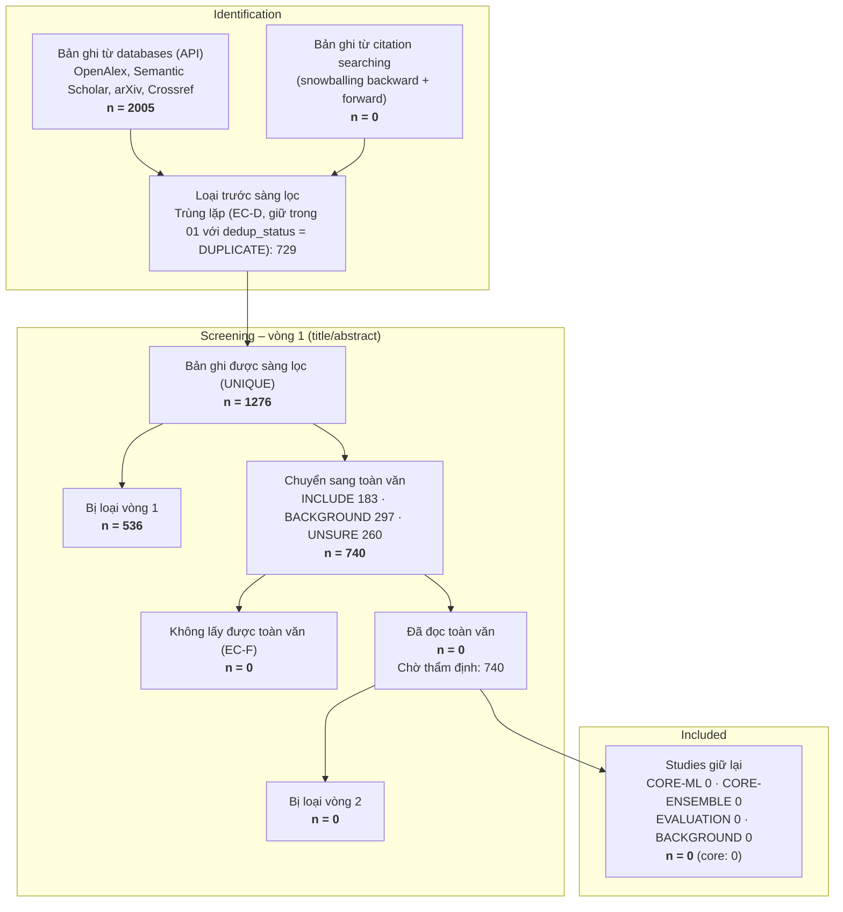

# Search & Screening Flow – phat-tai

> **Đề tài:** *A Reproducible and Leakage-Aware Evaluation of Ensemble Learning for FR/NFR Requirements Classification*  
> **Người chạy:** phat-tai | **Cập nhật:** 2026-10-09 | **Protocol:** `fr_nfr_ensemble_research/protocol/research_protocol.md` research_protocol.md v1.1 (2026-10-09)  
> **Cách sinh:** tính tự động từ `01_all_records.csv`, `review-decisions.csv` và `search-runs/*.json` bằng `tools/frnfr-metadata-fetcher/cli.mjs screen` (v3.0.0-frnfr).
> Đây là **targeted literature review** có ghi nhật ký tìm kiếm, không phải SLR/PRISMA đầy đủ.

> ⚠️ Vòng 1 (title/abstract) là **gợi ý tự động** theo luật từ khoá (`reviewer = auto-rules`) cho mọi bản ghi chưa có dòng `stage=V1` trong `review-decisions.csv`.
> Vòng 2 chỉ tính các bài **đã đọc toàn văn** và có dòng `stage=V2`; bài chưa đọc được ghi là *chờ thẩm định*, không cộng vào số included.

## 1. Sơ đồ tìm kiếm và sàng lọc

---

## 2. Identification

### 2.1 Bản ghi theo nguồn × search stream

Số dòng ghi vào `01_all_records.csv` (kể cả bản trùng, được giữ làm audit trail). Stream lấy theo lần cào **đầu tiên** tìm thấy bản ghi.

| Nguồn \ Stream | Q1 | Q1b | Q2 | Q3 | Q4 | Q5 | T1 | T2 | Tổng |
|---|---:|---:|---:|---:|---:|---:|---:|---:|---:|
| OpenAlex | 200 | 200 | 55 | 110 | 32 | 52 | 100 | 100 | 849 |
| Semantic Scholar | 200 | 200 | 38 | 76 | 23 | 37 | 100 | 70 | 744 |
| arXiv | 81 | 187 | 5 | 5 | 21 | 3 | 100 | 10 | 412 |
| **Tổng** | 481 | 587 | 98 | 191 | 76 | 92 | 300 | 180 | **2005** |

### 2.2 Phễu trước sàng lọc

| Bước | Databases | Citation searching | Tổng |
|---|---:|---:|---:|
| Bản ghi ghi vào 01 | 2005 | 0 | **2005** |
| Trùng lặp (EC-D, `dedup_status = DUPLICATE`) | 729 | 0 | 729 |
| **Bản ghi UNIQUE đưa vào sàng lọc** | 1276 | 0 | **1276** |

Không ghi vào 01 (bộ lọc của lần cào, chi tiết trong `search-log.md`): ngoài khung năm 0; lạc đề ở nguồn không hỗ trợ boolean (Crossref/CORE, giữ khi khớp ≥ nửa số nhóm của chuỗi) 0.

IEEE Xplore, ACM DL, Scopus, Web of Science không có API dùng được: tra tay bằng bản dịch chuỗi (giao diện extension) và ghi vào `search-log.md`, hoặc ghi `NOT_AVAILABLE`.

---

## 3. Screening – vòng 1 (title/abstract)

| Quyết định | Databases | Citation searching | Tổng | Tỷ lệ |
|---|---:|---:|---:|---:|
| INCLUDE | 183 | 0 | 183 | 14.3% |
| BACKGROUND | 297 | 0 | 297 | 23.3% |
| UNSURE | 260 | 0 | 260 | 20.4% |
| EXCLUDE | 536 | 0 | 536 | 42.0% |
| **Tổng** | 1276 | 0 | **1276** | 100% |

Lý do loại vòng 1 (một mã chính mỗi bản ghi, theo thứ tự EC-D → EC-Y → EC-G → EC-S → EC-T → EC-E):

| Mã | Lý do | Số lượng |
|:---:|---|---:|
| `EC-S` | OUT_OF_SCOPE: không phải phân loại requirements | 467 |
| `EC-G` | Gray literature / dataset | 46 |
| `EC-T` | WRONG_TASK: sai nhiệm vụ / loại văn bản / không dùng ML | 16 |
| `EC-Y` | Ngoài khung năm / không phải tiếng Anh | 7 |

Người quyết định: `auto-rules v3.0.0-frnfr` 1276.

---

## 4. Eligibility – vòng 2 (toàn văn)

| Bước | Databases | Citation searching | Tổng |
|---|---:|---:|---:|
| Chuyển sang toàn văn | 740 | 0 | 740 |
| Không lấy được toàn văn (EC-F) | 0 | 0 | 0 |
| Đã đọc toàn văn | 0 | 0 | 0 |
| Bị loại vòng 2 | 0 | 0 | 0 |
| Giữ lại | 0 | 0 | 0 |
| **Chờ thẩm định toàn văn** | 740 | 0 | **740** |

Lý do loại vòng 2:

| Mã | Lý do | Số lượng |
|:---:|---|---:|
| — | — | 0 |

---

## 5. Included

| Nhãn | Số study | Ghi chú |
|---|---:|---|
| CORE-ML | 0 | Nhóm 1: FR/NFR + ML cổ điển / NLP (mục tiêu 3–4) |
| CORE-ENSEMBLE | 0 | Nhóm 2: ensemble trong phân loại yêu cầu (mục tiêu 3) |
| EVALUATION | 0 | Nhóm 3: dataset / split / cross-project / leakage (mục tiêu 3–4) |
| BACKGROUND | 0 | Nhóm 4: survey / phương pháp / bối cảnh (mục tiêu 2) |
| **Tổng giữ lại** | **0** | |

Core có QA ≥ 6/10: **0** / 0; còn lại gắn `LOW-CONFIDENCE` hoặc chưa chấm QA.
Mục tiêu bản 4 tuần (gate G2): **≥ 12 bài đọc toàn văn**, đủ 4 nhóm.
